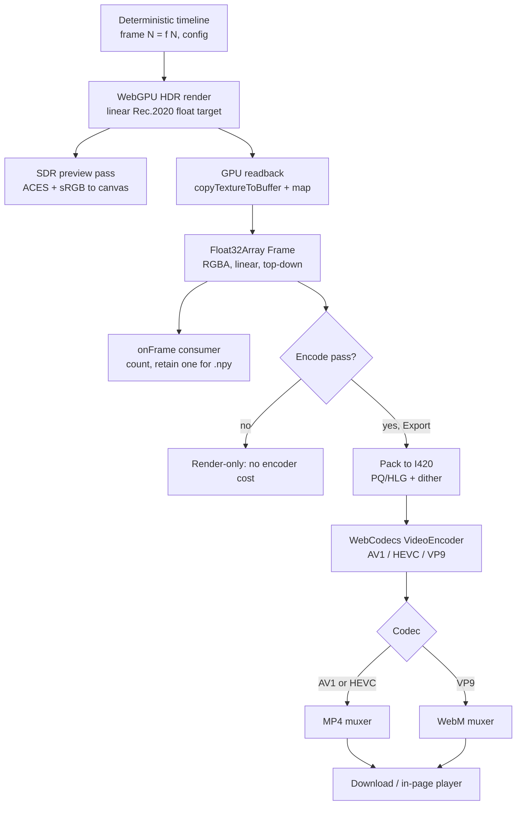

# HDR frame renderer — Rec. 2020 / Rec. 2100 POC

A browser-only proof of concept that renders a deterministic 10-second, 30 fps
HDR sequence in linear **Rec. 2020**, returns the frames to JavaScript as float
arrays, shows an SDR preview while rendering, and can encode the frames into a
downloadable **10-bit HDR video** (AV1 or VP9, depending on what the browser
exposes).

No rendering or media service is involved; everything runs in the page.

---

## Contents

- [Quick start](#quick-start)
- [What the brief asked for](#what-the-brief-asked-for)
- [Architecture](#architecture)
- [Colour pipeline](#colour-pipeline)
- [Rendering](#rendering)
- [Frame delivery](#frame-delivery)
- [Encoding and containers](#encoding-and-containers)
- [Determinism](#determinism)
- [Performance notes](#performance-notes)
- [Decisions and rationale](#decisions-and-rationale)
- [Known limitations](#known-limitations)
- [Verification performed](#verification-performed)
- [Optimisation roadmap](#optimisation-roadmap)
- [File map](#file-map)
- [Open items](#open-items)

---

## Quick start

```bash
pnpm install
pnpm dev          # http://localhost:5173/
pnpm build        # tsc + vite production build
```

Requirements: a WebGPU-capable Chrome or Firefox. WebCodecs export additionally
requires `VideoEncoder` with a 10-bit profile (see
[Encoding and containers](#encoding-and-containers)).

Two UI paths:

- **Start** — render 300 frames, show the SDR preview, return each frame through
  `onFrame`. No encoding; this is the fast path.
- **Export HDR video** — re-render the same timeline headlessly and encode it
  offline, then mux to a container. **Download video** saves the result;
  **Compare like preview** displays an exported frame through the preview's own
  tone curve so the two can be compared fairly.

Logging is verbose by default. `?verbose=0` disables `info`/`debug` lines;
warnings and errors are always emitted. `/codec-probe.html` is a standalone
diagnostic that reports which encoder configurations the current browser
accepts.

---

## What the brief asked for

| Requirement | Status |
|---|---|
| Repository with implementation and README explaining decisions | This document |
| Rendering inside the browser, no separate service | WebGPU + WebCodecs only |
| 1280×720, 10 seconds, 30 fps | 300 frames at 30 fps |
| HDR coloured background | Full-frame linear Rec. 2020 gradient, values above 1.0 |
| Three 100×100 shapes, different Rec. 2020 colours | Three quads, each with a distinct high-chroma HDR colour |
| Per-frame animation: translate, rotate, scale, skew, opacity | All five, independently animated |
| Float array frames returned | `Float32Array` RGBA per frame via `onFrame` |
| Frames shown during rendering (SDR estimate acceptable) | ACES tone-mapped sRGB preview |

Nice-to-haves:

| Nice-to-have | Status |
|---|---|
| Optimisation planning | [Optimisation roadmap](#optimisation-roadmap) |
| Browser-issue description | [Known limitations](#known-limitations) |
| Frames → encoder → true HDR video | Implemented (AV1/MP4 or VP9/WebM) |
| Accurate HDR display during rendering | Not implemented (SDR estimate only) |
| Text rendering | Not implemented |

The brief explicitly states there is no hard requirement to produce a video;
frame generation is the core. The encoded-video path is nonetheless implemented
and verified, with its constraints documented.

---

## Architecture



Two passes, deliberately:

1. **Preview pass** (`run`) renders, presents an SDR estimate, and delivers
   float frames. It passes `encoderTap: null`, so it pays no encoding cost and
   cannot be throttled by encoder back-pressure.
2. **Export pass** (`exportVideo`) re-renders the same frames headlessly
   (`previewCanvas: null`), encodes them, and muxes the result.

Re-rendering rather than caching is possible because frame content is a pure
function of the index. Caching all 300 frames at float32 would require ~4.4 GB;
re-rendering costs about ten seconds and is always correct.

---

## Colour pipeline

**Working space: linear Rec. 2020.** Shader outputs and blending stay in linear
light for the entire scene pass; no transfer function and no clamping is applied
before readback. Highlights above 1.0 survive intact.

**Reference white: 100 nits.** A scene-linear value of `1.0` means 100 nits. PQ
normalises against its 10 000-nit peak and HLG against a 1000-nit reference, so
authored values retain headroom above diffuse white. The three shapes peak
between 2.7 and 5.6 scene-linear (270–560 nits).

**Encode targets are Rec. 2100.** The encoder is configured and tagged with
`primaries: bt2020`, `transfer: pq` or `hlg`, `matrix: bt2020-ncl`, limited
range. Both containers carry that description explicitly (see below), because
browsers frequently omit colour metadata from the bitstream.

**8-bit source precision.** WebCodecs' `VideoFrame(BufferSource)` constructor
rejects 10-bit formats in current browsers, so the encoder input is 8-bit
planar `I420` (with `RGBA` as a last resort). The packer performs the Rec. 2020
RGB→YUV conversion and limited-range quantisation itself (Y 16..235, C 16..240)
and applies an **8×8 ordered (Bayer) dither** before rounding, so smooth PQ
gradients degrade into fine texture rather than visible bands. 10-bit is not
reachable through this path; see [Known limitations](#known-limitations).

**PQ/HLG application.** The packer samples a 4096-entry transfer LUT indexed by
`sqrt(linear)`, which concentrates table resolution in perceptually important
shadows. Values above 16 scene-linear are clipped by the table.

---

## Rendering

- **WebGPU** renders into an offscreen `rgba16float` target, or `rgba32float`
  when the adapter exposes both `float32-renderable` and `float32-blendable`.
  `rgba16float` is always renderable and blendable in core WebGPU.
- **Blending is linear and premultiplied.** Fragments emit `rgb * alpha` and the
  pipeline blends `one` / `one-minus-src-alpha`, which avoids dark fringes when
  translucent shapes composite over HDR values. Blending in an encoded space is
  the most common colour bug in this kind of renderer and is deliberately
  avoided.
- **Analytic antialiasing.** Shape coverage is derived from `fwidth(localUv)`
  and folded into premultiplied alpha, so rotated and skewed edges are smooth
  without an MSAA target or a resolve pass.
- **Transform composition** is resolved once on the CPU: shape-local pixels →
  design pixels → WebGPU NDC. Design space is 1280×720, origin top-left, +Y
  down; the Y flip to NDC +Y up happens in exactly one place.
- **Transforms** apply as translate ∘ rotate ∘ skew ∘ scale about the shape
  centre, then translate to the animated design-space position.
- **Preview** samples the HDR target with `textureLoad`, applies the Narkowicz
  2015 ACES approximation in linear light, then sRGB encoding into a
  non-sRGB swap-chain. It is an estimate, not a colour-managed SDR render.

---

## Frame delivery

Each frame is copied from the HDR target into a `MAP_READ` staging buffer and
mapped. The staging ring holds three buffers by default with a lookahead of two,
so one GPU copy overlaps the previous frame's CPU unpack.

- `rgba32float` readbacks are row-copied into a tightly packed array.
- `rgba16float` readbacks are decoded through a 65536-entry half→float table.
- Frames are delivered as `Float32Array` RGBA in `onFrame`, then released. The
  workbench retains only the frame selected for `.npy` download.

A 1280×720 float32 RGBA frame is **14,745,600 bytes (~14.75 MB)**. Retaining all
300 would cost ~4.4 GB, so the pipeline streams and releases.

**Bounded memory.** `maxFramesInFlight` defaults to 2; `reuseOutputBuffer`
trades overlap for zero per-frame allocation (see the roadmap — not enabled by
default).

---

## Encoding and containers

**Selection.** The tap probes codec strings in preference order with
`VideoEncoder.isConfigSupported` and validates that the chosen codec has a
container. The probe results are always logged:

```
[encoder] Codec probe results { requested, results, selected }
```

Observed on the development machine. Chrome results come from
`/codec-probe.html`; the Firefox entry is inferred from a successful export
before WebM support existed, when only AV1/HEVC could have been selected.

| Codec | Chrome | Firefox |
|---|---|---|
| `hvc1.2.4.L93.B0` (HEVC Main10) | not supported | not established |
| `av01.0.08M.10` (AV1 Main10) | not supported | export succeeded → MP4 |
| `vp09.02.31.10` (VP9 Profile 2, 10-bit) | supported → WebM | not established |
| `avc1.640028` (H.264 High) | supported, **excluded** (8-bit, cannot carry PQ) | not established |

Chrome's encoder availability varied between sessions during development
(an earlier run did select AV1). Encoder capability is treated as dynamic, not
as a fixed property of the browser; `/codec-probe.html` exists to inspect it.

**Back-pressure.** Software encoders run well below the pipeline's submit rate.
The pipeline stops submitting when `encodeQueueSize` reaches **8** and waits for
a mid-run drain (`VideoEncoder.flush()` without closing), which keeps memory
flat and makes the final flush a handful of frames rather than hundreds. The
final flush is bounded at **30 s**, after which a wedged encoder is force-closed
and reported as a warning instead of hanging the run.

**Containers.** Both muxers are hand-written with no runtime dependencies:

- **`mp4Muxer.ts`** — progressive MP4: `ftyp`, `mdat`, `moov`; one visual sample
  entry (`av01`, `hvc1`, or `avc1`) with the codec configuration record,
  `colr` as `nclx` (primaries 9, transfer 16/18, matrix 9, limited range), and
  `pasp` 1:1. `stts`/`stss`/`stsc`/`stsz`/`stco` describe timing and offsets.
  Chrome's AV1 encoder supplies no `decoderConfig.description`, so `av1C` is
  reconstructed from the codec string plus the sequence-header OBU in the first
  key frame; HEVC/H.264 use the encoder's description verbatim.
- **`webmMuxer.ts`** — EBML/Matroska: `EBML`, `Segment`, `SeekHead`, `Info`,
  `Tracks` (`V_VP9`), `Cluster`/`SimpleBlock`, and a `Cues` index. The `Colour`
  element carries matrix 9, 10 bits per channel, 4:2:0, limited range, transfer
  16/18, primaries 9.
- **`videoContainer.ts`** routes by codec: VP8/VP9 → WebM, AV1/HEVC/H.264 → MP4,
  and rejects anything else *before* encoding starts.

**Fair comparison.** Raw PQ on an SDR display looks far darker than an ACES
tone-mapped preview, so the app ships a **Compare like preview** control that
decodes an exported frame and re-applies the preview's exact ACES + sRGB curve.
With the transfer curve equalised, the exported frame matches the preview, which
confirms there is no content divergence between the two passes.

---

## Determinism

`getSceneAtFrame(frameIndex, config)` is a pure function of the index and config:
no wall-clock time, no accumulated state, no randomness. Animation phase is
`frameIndex / frameCount` with integer cycle counts, so a full run loops
seamlessly.

Verified directly against the implementation:

- the same index evaluated twice produces byte-identical scene data;
- evaluating all 300 frames forward and in reverse produces identical results,
  proving no hidden state;
- the identity transform maps the 100×100 box centred at (420, 330) to the
  expected clip coordinates, and +90° rotation turns local +X toward design +Y;
- the frame 299 → 0 transition steps by **1.00×** a normal frame step across all
  animated channels, confirming the loop seam.

This property is what makes the two-pass export cheap and trustworthy.

---

## Performance notes

Measured on the development machine during this build; treat as indicative, not
as benchmarks.

- **Frame production** reached ~50 fps in the submit-bound phase.
- **Software AV1 encoding** sustained ~20–26 fps — below the submit rate, so an
  unbounded queue grows for the whole run.
- Before back-pressure, the queue reached **170 frames** and the final flush took
  **7.7 s**, tripping the 5-second stall watchdog. After adding the drain
  threshold this becomes a short, bounded final flush.
- **Readback allocation** is 14.75 MB per frame (~380–750 MB/s at observed
  rates). These land in V8's large-object space and produce periodic major GCs,
  which is the likely cause of stutter in long runs. `reuseOutputBuffer` removes
  it at the cost of copy/unpack overlap.
- Encoding is **offline**, not real-time: "10 seconds" is the media duration,
  not a wall-clock deadline. The export pass is expected to take longer than the
  render pass.

---

## Decisions and rationale

| Decision | Reason |
|---|---|
| **WebGPU over WebGL/Canvas 2D** | First-class float render targets, explicit texture formats, deterministic command ordering, and no 8-bit canvas intermediate for the HDR render. |
| **Linear float render target, no clamping** | HDR values above 1.0 must survive until tone mapping or encoding; an 8-bit SDR target would destroy them before they are ever used. |
| **Premultiplied alpha, linear blending** | Correct compositing of translucent emissive shapes over HDR values; avoids dark fringes and gamma-space blending errors. |
| **CPU readback rather than GPU-direct encode** | WebCodecs accepts neither `GPUTexture` nor a GPU handle as encoder input, so frames must reach CPU memory. |
| **Analytic AA instead of MSAA** | MSAA would need a multisampled float target plus a resolve before readback/encode; `fwidth` coverage is cheaper, deterministic, and needs no extra texture. |
| **Deterministic timeline** | Frames can be produced out of order, re-rendered for export, and tested without drift; it is also what makes deferred encoding viable. |
| **Two-pass render and export** | Keeps encoder cost, memory, and back-pressure out of the interactive preview; a render-only run never constructs an encoder. |
| **Deferred (offline) encoding** | No real-time constraint exists. Encoding on demand avoids taxing every run and lets the export target a codec chosen at export time. |
| **Re-render for export instead of caching frames** | 300 float32 frames is ~4.4 GB; re-rendering is ~10 seconds and always consistent. |
| **8-bit I420 fallback with dither** | It is the highest-precision CPU-constructible input Chrome currently allows, and dithering removes the banding that 8-bit PQ would otherwise show. |
| **Hand-written MP4 and WebM muxers** | No runtime dependency, and full control over colour metadata — the common reason an "HDR" file plays as SDR. |
| **Container chosen per codec** | Chrome exposes VP9 but not AV1/HEVC; Firefox exposes AV1. Forcing one container makes one browser fail. WebM/VP9 is not a deviation from the brief — the brief specifies no container. |
| **Fail before encoding if the codec cannot be muxed** | A full encode followed by a container error wastes time and hides the real cause. |
| **Stall watchdog with bounded flush** | A wedged encoder or GPU map must produce diagnostics and terminate, not hang the page. |

---

## Known limitations

**Precision / HDR**
- Encoder input is 8-bit. Chrome rejects 10-bit `VideoFrame(BufferSource)`
  formats, so "true 10-bit HDR" is not reachable through the native path.
  Dithering mitigates banding but does not add bits. A WASM or native encoder
  accepting 16-bit samples would be required.
- The preview is an **estimate**: ACES tone mapping plus sRGB, with no
  Rec. 2020 → Rec. 709 gamut conversion. Saturated Rec. 2020 colours are not
  colour-managed on screen.
- HDR display during rendering is not implemented; the live preview is SDR.
- Master display (`mdcv`) and content light (`clli`) metadata are not written.
  Only primaries/transfer/matrix/range are.

**Codecs and containers**
- Encoder availability is inconsistent across browsers and can change between
  sessions or with hardware/flag/policy state. VP9-in-WebM plays in Chrome and
  Firefox; Safari's VP9/WebM and HDR handling is inconsistent and should not be
  relied on.
- Encoder output on this synthetic content is far below the configured bitrate:
  one run produced 433,725 bytes for 300 frames, i.e. **~347 kbit/s against an
  8.3 Mbit/s target (~4%)**. `bitrateMode: 'variable'` with
  `latencyMode: 'quality'` has no reason to spend bits on flat regions, so the
  target mostly informs rate-control heuristics here rather than being a
  quality guarantee.
- Software encoders are slow; hardware encoders may be unavailable or exhausted.

**Pipeline**
- Per-frame readback allocates 14.75 MB unless `reuseOutputBuffer` is enabled.
  This is the dominant source of GC pressure.
- An in-flight GPU readback can still stall after device loss; there is no
  timeout on `mapAsync`.
- The whole encoded file is held in memory for muxing. Fine at this duration;
  a longer or higher-bitrate export should stream to disk.

**Project**
- No automated tests or CI. Verification was performed with ad-hoc harnesses
  (see below) which were removed afterwards.
- No audio track, and no multi-track interleaving.

---

## Verification performed

Build:
- `pnpm build` (`tsc` + Vite) passes.

Determinism and transforms:
- Reproducibility and order-independence over all 300 frames.
- Identity and +90° rotation checked against expected clip coordinates.
- Loop seam measured at 1.00× a normal frame step.

MP4 muxer:
- Independent parse of the produced box tree; every parent exactly filled.
- `colr` = `nclx` / 9 / 16 / 9 / limited range.
- `av1C` byte-identical to the encoder description when supplied, and
  byte-verified when synthesised from the codec string and sequence header.
- `stco` addresses the `mdat` payload; `stsz` sizes sum to it; `stss` lists the
  key frames; `mdhd` duration matches `frames / fps`.

WebM muxer:
- Independent EBML walk of every element.
- `Colour` fields = matrix 9 / 10-bit / 4:2:0 / limited / PQ / primaries 9.
- `SeekHead` positions resolve to `Info` and `Tracks`; `Cues` positions resolve
  to real `Cluster` elements.
- Block timestamps monotonic and within the signed 16-bit cluster range.

Colour maths:
- PQ encode/decode round-trip exact to 1e-6.
- The packer → comparison chain recovers the original scene-linear value to
  1e-4.
- Standard PQ landmarks confirmed (100 nits → 0.5081, 1000 nits → 0.7518).

End-to-end:
- The exported frame, tone-mapped with the preview curve, matches the live
  preview. This distinguishes a real content bug from the expected transfer
  function difference and is the strongest evidence that render, pack, encode,
  mux, and decode are consistent.

**Not verified:** playback on an actual HDR display; Safari behaviour; long-run
stability; automated regression coverage; real-device colour accuracy.

---

## Optimisation roadmap

Ordered by expected value for effort:

1. **Enable `reuseOutputBuffer`** in the preview pass to eliminate 14.75 MB of
   per-frame allocation and the associated major GCs. Trade-off: loses
   copy/unpack overlap (depth forced to 1).
2. **Pack directly from the mapped readback buffer** in the export pass, skipping
   the float32 expansion entirely (half-float → I420) for a full pass over the
   pixels saved.
3. **Rec. 2020 → Rec. 709 gamut mapping** in the preview so the SDR estimate is
   colour-correct rather than merely tone-mapped.
4. **Worker offload** for pack + encode. WebCodecs is available in dedicated
   workers and `VideoFrame` is transferable; this removes encoder contention from
   the main thread entirely.
5. **Stream muxing to OPFS / File System Access** instead of buffering the file.
6. **GPU-side YUV conversion** so the encoder input is produced by a compute
   pass rather than a per-pixel CPU loop.
7. **Half-float frame delivery** instead of float32 expansion.
8. **WASM/native 10-bit encoder** if source precision matters more than
   integration cost.

---

## File map

```
src/
  main.ts                     app entry
  timeline/
    sceneAnimator.ts          pure frame → SceneState; Rec.2020 colours
    easing.ts                 easing/pulse helpers
  math/
    mat3.ts                   2D affine composition, design→clip
  gpu/
    context.ts                adapter/device, format negotiation, device loss
    hdrRenderer.ts            HDR target, shape/background pipelines
    previewRenderer.ts        SDR presentation pass
    readback.ts               staging ring, half→float decode, output policy
    webgpuFlags.ts            numeric WebGPU enum constants
    shaders/
      hdrScene.wgsl           linear HDR background + AA shape quads
      sdrPreview.wgsl         ACES + sRGB presentation
  pipeline/
    framePipeline.ts          run loop, back-pressure, flush, telemetry
  encoder/
    webCodecsTap.ts           codec probe, packing, PQ/HLG, dither
    videoContainer.ts         codec → container routing
    mp4Muxer.ts               dependency-free MP4 writer
    webmMuxer.ts              dependency-free WebM writer
    videoComparison.ts        preview-matched decode for comparison
  ui/
    workbench.ts              DOM, controls, export flow
  diagnostics/
    logger.ts                 scoped, timestamped console logging
  types/
    frame.ts                  shared types
public/
  codec-probe.html            standalone encoder capability report
```

---

## Open items

- [x] Rec. 2020 linear rendering with animated shapes
- [x] Float array frames through `onFrame`
- [x] SDR preview during rendering
- [x] Deterministic timeline, verified
- [x] WebCodecs encode with back-pressure and bounded flush
- [x] MP4 (AV1/HEVC) and WebM (VP9) muxing with Rec. 2100 metadata
- [x] Preview-matched comparison to validate export fidelity
- [ ] Automated tests and CI
- [ ] `reuseOutputBuffer` for the preview pass
- [ ] Rec. 2020 → Rec. 709 gamut mapping in the preview
- [ ] Text rendering
- [ ] Accurate HDR display during rendering
- [ ] `mdcv` / `clli` container metadata
- [ ] 10-bit source precision (WASM or native encoder)
